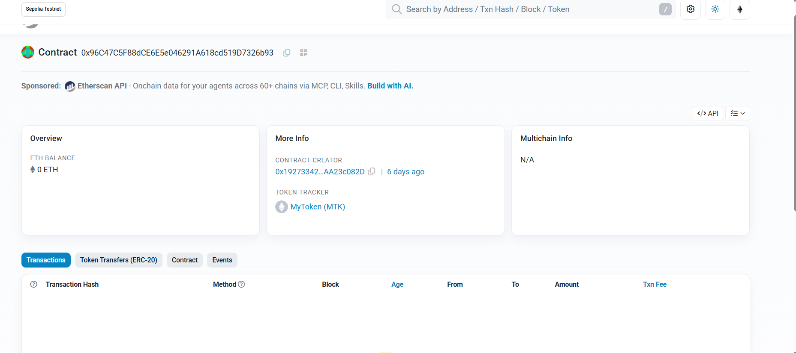

# Assignment 5 – ERC-20 Token Development

## Deployment

The contract was successfully deployed to the Sepolia Testnet.

**Contract Address:**

`0x96C47C5F88dCE6E5e046291A618cd519D7326b93`

**Blockchain Explorer:**

[View MyToken on Etherscan – Sepolia](https://sepolia.etherscan.io/address/0x96C47C5F88dCE6E5e046291A618cd519D7326b93)

### Blockchain Explorer Screenshot

The following screenshot shows the deployed smart contract on the Sepolia blockchain explorer.

